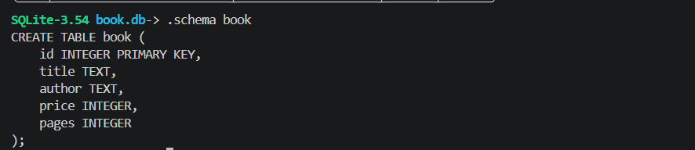
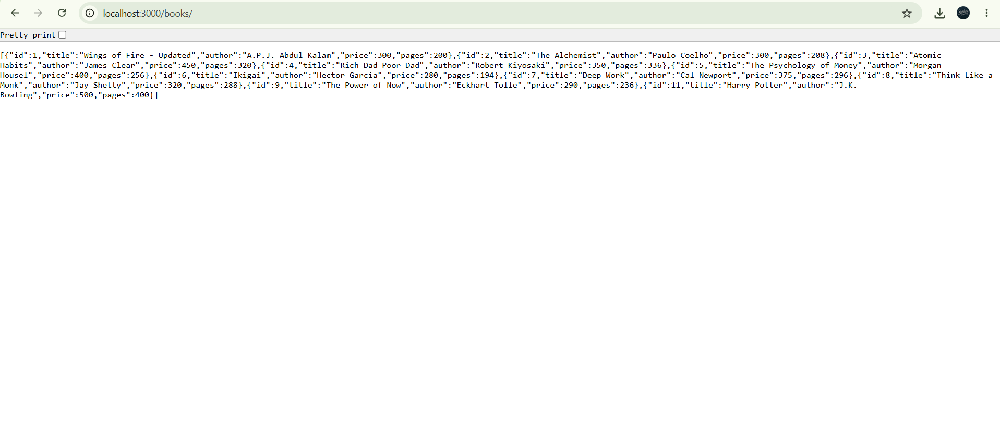
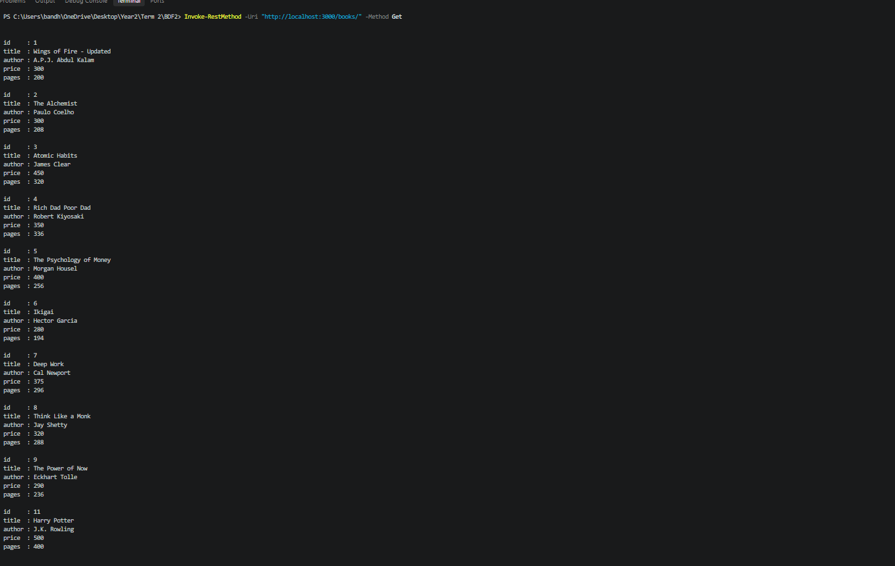
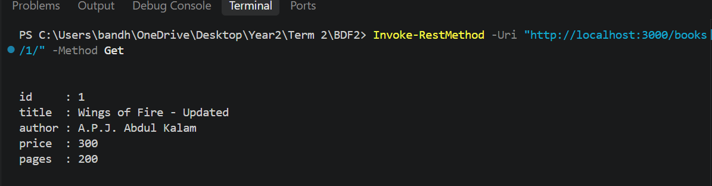
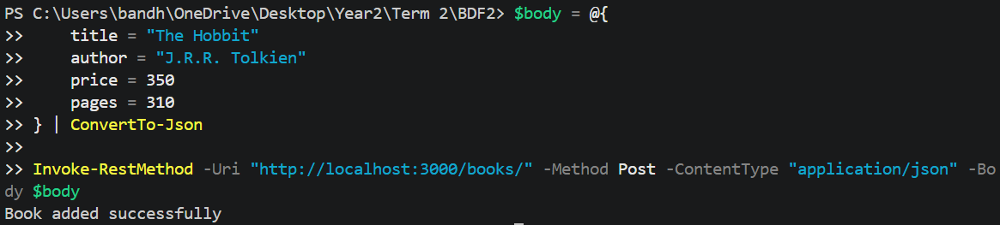
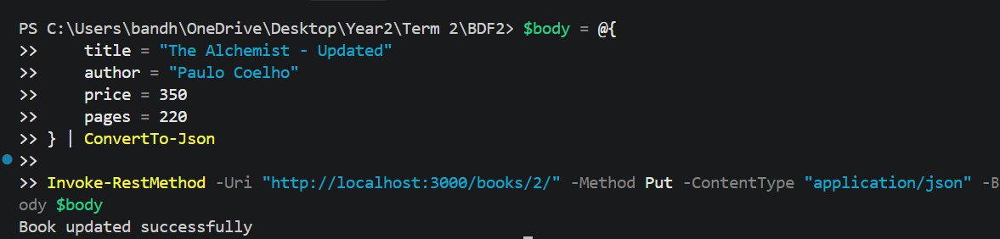
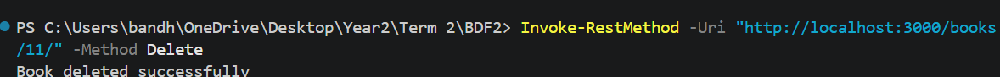
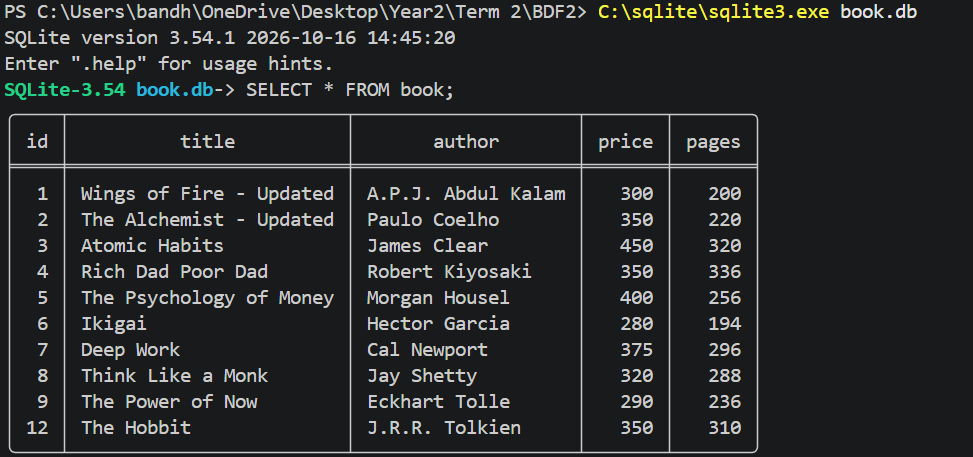

# Lab 2 – SQLite Database and CRUD Operations

**Live Deployment:**https://bdf2-sqlite-crud.onrender.com/books/

**GitHub Repository:** https://github.com/anirudh2007-cell/BDF2

---

## Student Details

- **Name:** Anirudh Bandhela
- **Registration Number:** 252U1R1025
- **Section:** CSE 2A, 223
- **Subject:** Backend Development Fundamentals
- **Lab Number:** 02
- **Lab Title:** SQLite Database and CRUD Operations

---

## Project Description

This project implements a Book Management API using Node.js, Express.js and SQLite.

The application performs CRUD operations (Create, Read, Update and Delete) on book records stored in an SQLite database.

The project contains five API endpoints to retrieve all books, retrieve a book by ID, add a new book, update an existing book and delete a book.

---

## Technologies Used

- Node.js
- Express.js
- SQLite
- SQLite3
- JavaScript
- Nodemon
- PowerShell
- Render (Deployment)

---

## Project Structure

```text
BDF2/
│
├── database.js
├── server.js
├── book.db
├── package.json
├── package-lock.json
├── .gitignore
├── README.md
│
└── screenshots/
    ├── database-records.png
    ├── database-schema.png
    ├── delete-book.png
    ├── final-database.png
    ├── get-all-books.png
    ├── get-book-by-id.png
    ├── post-add-book.png
    └── put-update-book.png
```

---

## Installation and Setup

### 1. Clone the Repository

```bash
git clone https://github.com/anirudh2007-cell/BDF2.git
```

### 2. Open the Project Folder

```bash
cd BDF2
```

### 3. Install Dependencies

```bash
npm install
```

### 4. Start the Development Server

```bash
npm run dev
```

The server runs at:

```text
http://localhost:3000
```

To start the application without Nodemon:

```bash
npm start
```

---

## Environment Variables

The application supports the following environment variables:

| Variable | Description |
|---|---|
| PORT | Port number used by the server |
| DB_PATH | Path to the SQLite database file |

Default values:

- PORT: 3000
- DB_PATH: ./book.db

No secret environment variable values are included in this repository.

---

## Database Details

**Database Name:** book.db

**Table Name:** book

### Table Schema

| Column | Data Type | Description |
|---|---|---|
| id | INTEGER | Primary Key |
| title | TEXT | Book title |
| author | TEXT | Book author |
| price | INTEGER | Book price |
| pages | INTEGER | Number of pages |

The database initially contains 10 book records.

---

## API Endpoints

Base URL (Local):

```text
http://localhost:3000
```

Base URL (Deployed):

```text
https://bdf2-sqlite-crud.onrender.com
```

### 1. GET – Retrieve All Books

**Endpoint:**

```http
GET /books/
```

Retrieves all book records from the database.

### 2. GET – Retrieve a Book by ID

**Endpoint:**

```http
GET /books/:bookId/
```

Retrieves a particular book using its ID.

Example:

```http
GET /books/1/
```

### 3. POST – Add a New Book

**Endpoint:**

```http
POST /books/
```

Adds a new book to the database.

Example JSON body:

```json
{
    "title": "The Great Gatsby",
    "author": "F. Scott Fitzgerald",
    "price": 250,
    "pages": 180
}
```

### 4. PUT – Update a Book

**Endpoint:**

```http
PUT /books/:bookId/
```

Updates the details of an existing book.

Example:

```http
PUT /books/1/
```

Example JSON body:

```json
{
    "title": "Wings of Fire - Updated",
    "author": "A.P.J. Abdul Kalam",
    "price": 300,
    "pages": 200
}
```

### 5. DELETE – Delete a Book

**Endpoint:**

```http
DELETE /books/:bookId/
```

Deletes a book from the database using its ID.

Example:

```http
DELETE /books/1/
```

---

## Testing

All five CRUD operations were tested successfully using PowerShell with `Invoke-RestMethod`.

Postman Desktop could not connect to the local server during testing, so PowerShell was used as an alternative testing method.

### Testing Results

| Operation | Result |
|---|---|
| GET all books | Successful |
| GET book by ID | Successful |
| POST new book | Successful |
| PUT update book | Successful |
| DELETE book | Successful |

A new book, "The Great Gatsby", was added, updated and subsequently deleted to verify the POST, PUT and DELETE operations.

The database was also checked using the SQLite command-line interface.

---

## Screenshots

### 1. Database Schema



### 2. Database Records



### 3. GET All Books



### 4. GET Book by ID



### 5. POST – Add Book



### 6. PUT – Update Book



### 7. DELETE – Delete Book



### 8. Final Database



---

## Deployment

The application has been successfully deployed using Render.

**Deployment Platform:** Render

**Live Application URL:**

https://bdf2-sqlite-crud.onrender.com

**Books API:**

https://bdf2-sqlite-crud.onrender.com/books/

**Get Book by ID:**

https://bdf2-sqlite-crud.onrender.com/books/1/

Note: The application exposes API routes. The root URL `/` does not have a homepage route.

---

## Important Notes

- User inputs are passed to SQL queries using parameterized placeholders (`?`).
- The database connection is established before the server starts.
- Nodemon is used for development.
- The `node_modules` folder is excluded from GitHub using `.gitignore`.
- Database files and project source code are included in the repository.

---

## Conclusion

This lab helped me understand SQLite database connectivity, SQL queries and CRUD operations using Node.js and Express.js.

I successfully implemented and tested all five required API endpoints and deployed the application using Render.

**Lab 2 Completed Successfully.**
